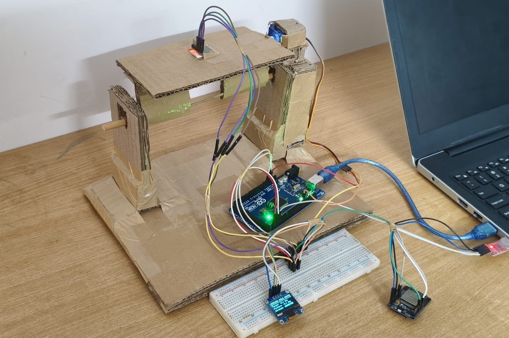
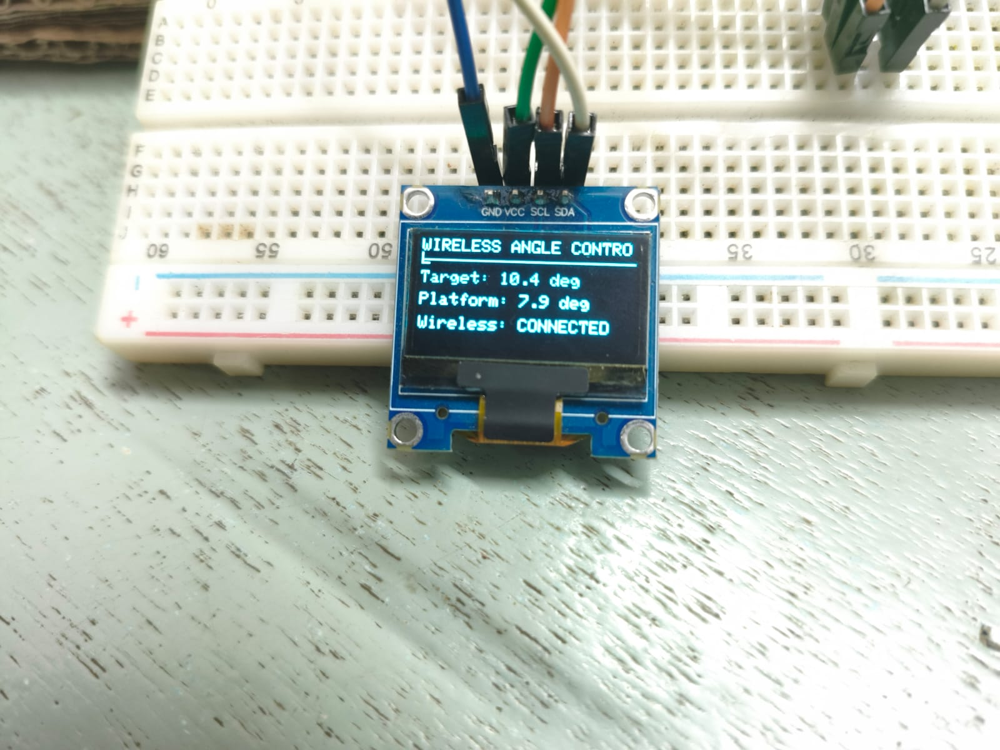
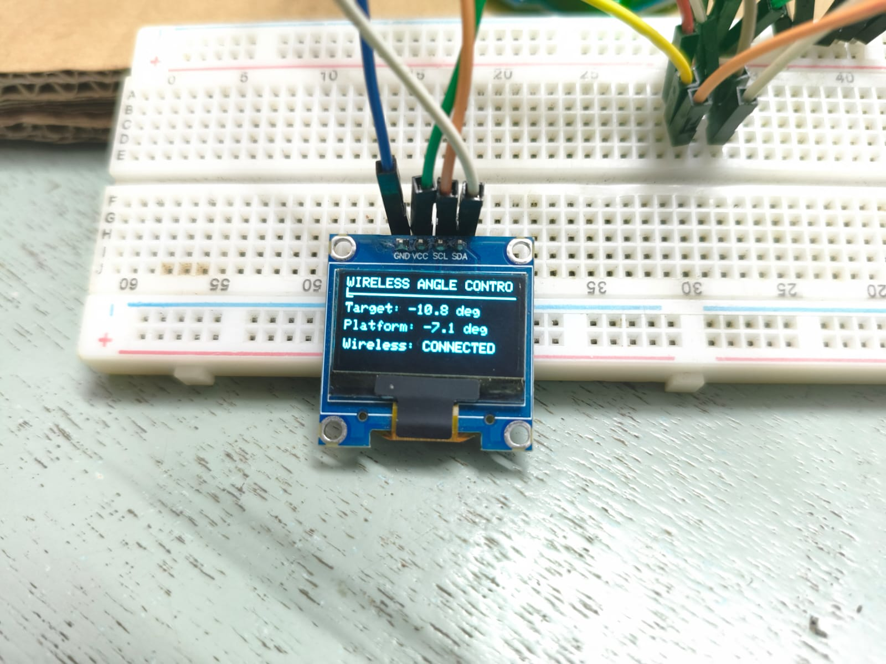

# Wireless IMU-Based Angle-Controlled Platform

A wireless handheld-controlled tilt platform using ESP32, MPU6050, Arduino Mega and servo-based feedback control.

## Project Overview

This project is designed to control the tilt angle of a physical platform using a target angle provided through a handheld controller.

The handheld controller uses an MPU6050 sensor and ESP32 to determine the desired tilt angle and transmit it wirelessly. A Wireless Receiver forwards the received target-angle data to an Arduino Mega, which measures the actual platform orientation and controls an SG90 servo using a feedback-based control algorithm.

The system integrates wireless communication, inertial sensing, embedded processing and servo actuation.

## Project Objectives

- Develop a wireless handheld target-angle controller.
- Transmit target-angle information through Wi-Fi.
- Receive and forward data through a wireless receiver and UART.
- Measure platform orientation using an MPU6050.
- Implement PI control with feed-forward compensation.
- Adjust platform tilt using a servo motor.
- Display relevant system readings using an OLED.

## System Architecture

The system is divided into three main subsystems:

1. **Handheld Controller** – Measures handheld orientation and generates the target angle.
2. **Wireless Receiver** – Receives target-angle data wirelessly and forwards it to the Arduino Mega through UART.
3. **Platform Controller** – Reads platform orientation, calculates the control response and drives the servo motor.

## Hardware Components

| Component | Quantity | Purpose |
|---|---:|---|
| ESP32 development board | 1 | Handheld target-angle processing and wireless transmission |
| MPU6050 IMU | 2 | Measures handheld and platform orientation |
| ESP32-based Wireless Receiver | 1 | Wireless reception and UART forwarding |
| Arduino Mega 2560 | 1 | Main platform controller |
| SG90 servo motor | 1 | Platform tilt actuation |
| OLED display | 1 | Displays platform and controller readings |

## Communication Architecture

The system uses Wi-Fi communication for wireless target-angle transmission and UART serial communication between the Wireless Receiver and Arduino Mega.

### Wireless Communication

The handheld ESP32 transmits the target-angle information to the Wireless Receiver using Wi-Fi.

### UART Communication

The Wireless Receiver forwards the received target-angle information to the Arduino Mega using UART serial communication.

### Sensor Feedback

The platform-mounted MPU6050 provides orientation measurements to the Arduino Mega. These measurements are used as feedback for the control algorithm.

### Actuation

The Arduino Mega generates servo commands based on the control response, adjusting the platform orientation.

## Hardware Integration

The handheld controller, wireless receiver and platform controller are integrated to provide target-angle input, wireless data transfer, feedback measurement and mechanical actuation.

The platform controller also includes an OLED display for observing system readings during operation.

## Control Algorithm

The platform controller uses a feedback control approach combining proportional control, integral control and feed-forward compensation (PI + FF).

The controller uses the desired target angle received from the handheld controller and the actual platform angle measured by the platform-mounted MPU6050.

### Angle Error

The controller calculates the difference between the desired angle and measured platform angle.

**Error = Target Angle - Platform Angle**

### Proportional Control (P)

The proportional contribution responds to the current angle error.

**P = Kp × Error**

### Integral Control (I)

The integral contribution accumulates error over time to compensate for persistent differences between the target and measured angles. The integral contribution is limited to reduce excessive accumulation.

### Feed-Forward Compensation (FF)

Feed-forward compensation provides an additional contribution based on the desired target angle, assisting the controller in generating an actuation response.

### Combined Control

The proportional, integral and feed-forward contributions are combined to generate the control response.

**Correction = P + I + FF**

The controller applies configured correction limits and servo position constraints before generating the servo command.

Additional processing includes target-angle smoothing and a deadband to reduce unnecessary response to small changes.

## Experimental Controller Configuration

| Parameter | Value |
|---|---:|
| Proportional gain (Kp) | 0.65 |
| Feed-forward gain (KFF) | 0.40 |
| Integral gain (Ki) | 0.12 |
| Integral limit | ±3.0 |
| Derivative control | Disabled |
| Target slew rate | 15°/s |
| Maximum correction | ±12 |
| Deadband | 0.7° |
| Servo centre | 90° |
| Servo minimum | 78° |
| Servo maximum | 102° |

These values are the experimental settings used during the recent prototype tuning stage.

## Experimental Observations

During testing, the platform responded to target-angle changes transmitted from the handheld controller.

The observed operation demonstrated:

- Wireless target-angle transmission from the handheld controller.
- Communication forwarding through the Wireless Receiver to the Arduino Mega.
- Platform-angle measurement using the MPU6050.
- Servo actuation in response to target-angle changes.
- OLED display of controller readings.
- Experimental tuning of the control parameters.

The platform demonstrated functional target-angle response. However, the response was influenced by servo limitations, mechanical behavior, sensor readings and controller tuning.

These observations represent prototype testing rather than formal quantitative performance measurements.

### Serial Monitor Evidence

Serial Monitor screenshots documenting the platform response at different target angles (positive, negative, smaller-angle and near-zero conditions) are available in the repository.
## Limitations

- The system is an experimental prototype, not a precision positioning platform.
- Servo travel and mechanical construction limit the platform movement.
- Sensor calibration and measurements affect the control response.
- Controller tuning may require further adjustment.
- Formal stability, response-time and positioning-accuracy measurements have not been conducted.

## Future Improvements

- Improve mechanical construction and stability.
- Improve sensor calibration and angle estimation.
- Investigate further controller tuning.
- Evaluate response under different target-angle conditions.
- Perform systematic quantitative testing.

## Conclusion

The project integrates wireless target-angle communication, inertial sensing, feedback-based control and servo actuation into a physical prototype.

The system demonstrates the practical integration of ESP32 wireless communication, MPU6050 sensor interfacing, UART communication, Arduino-based control and servo actuation.

## Project Images

### Prototype

### Platform Response at Positive Target Angle

### Platform Response at Negative Target Angle

## Source Code

The firmware is organized into three main components:

- `Handheld_ESP32.ino` – Handheld sensor processing and wireless target-angle transmission.
- `Wireless_Receiver.ino` – Wireless reception and UART forwarding.
- `Mega_Final_Controller.ino` – Platform feedback measurement, control computation and servo actuation.

The source code files will be available in the repository.

## Demonstration

The project demonstration video illustrates the handheld target-angle input and the corresponding physical platform response.

[Watch the project demonstration video](https://drive.google.com/file/d/1NsbuMGjx97qdFQom_y0Mo23i8CQ1qq2m/view?usp=sharing)

## Repository Contents

| Folder/File | Description |
|---|---|
| `Code/` | Firmware for the three system components |
| `Images/` | Prototype and OLED demonstration photographs |
| `Results/` | Serial Monitor screenshots and experimental evidence |
| `Demo/` | Demonstration video link or related files |

## Technologies Used

- Arduino C/C++
- ESP32
- Arduino Mega 2560
- MPU6050
- Wi-Fi communication
- UART serial communication
- PI control with Feed-Forward compensation
- Servo motor control
